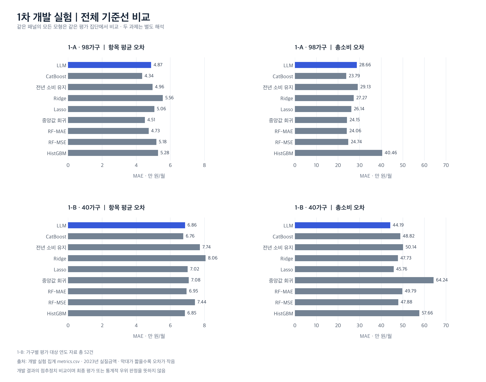
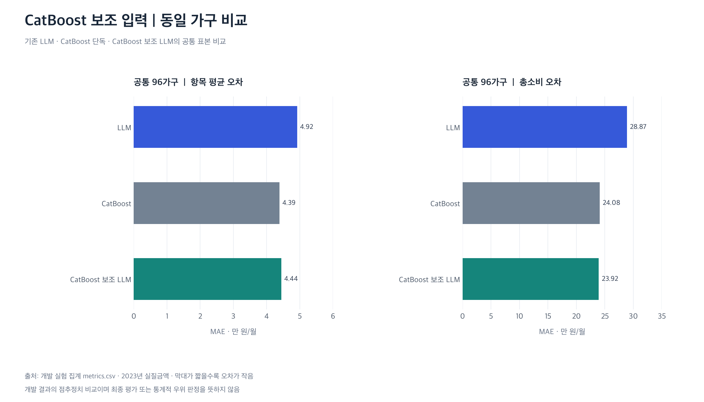

# 03. 개발 실험 결과

2026년 10월 21일까지 완료한 1차 개발 실험의 결과입니다. 1-A 일반 가구와 1-B 퇴직 관련 가구를 나누어 비교하고, 교육변화 가구와 CatBoost 보조 실험은 해당 공통 표본에서 따로 집계했습니다.

[전체 결과표](TABLES.md) · [집계 CSV](metrics.csv) · [추가 진단 수치](diagnostics.json)

## 1-A·1-B 기준선 비교

*그림 1. 항목 평균 MAE와 총소비 MAE 비교. 단위는 2023년 실질 만 원/월이며, 막대가 짧을수록 오차가 작습니다. 1-B는 40가구의 평가 대상 연도 자료 총 52건을 사용했습니다.*

1-A에서는 CatBoost의 항목·총소비 오차가 LLM보다 작았고, LLM은 전년 소비를 그대로 유지하는 기준선보다 소폭 나았습니다. 1-B에서는 LLM의 항목 오차가 CatBoost와 비슷했고, 총소비 오차는 비교 모형 중 가장 작았습니다.

다만 소비 변화까지 잘 재현했는지는 별도로 살펴볼 필요가 있었습니다. 1-B의 실제 평균 총소비 변화는 +91,769원이었으나 LLM은 −173,068원으로 재현했습니다. 가구 간 변화의 표준편차도 실제 696,827원에 비해 LLM은 310,167원으로 작았습니다. 총액의 오차가 작더라도 소비 변화의 방향이나 가구 간 차이를 충분히 재현하지 못할 수 있다는 점을 확인했습니다.

## CatBoost 참고 LLM

*그림 2. 세 조건을 비교할 수 있는 공통 96가구의 결과*

CatBoost 예측을 참고하게 했을 때 기존 LLM보다 항목 평균 MAE는 약 9.7%, 총소비 MAE는 약 17.1% 줄었습니다. CatBoost 단독과 비교하면 항목 오차는 약 1.3% 커지고, 총소비 오차는 약 0.7% 작아졌습니다.

항목 MAE 차이의 95% 구간은 기존 LLM 대비 약 −8,679~−2,126원, CatBoost 대비 약 −3,227~4,284원이었습니다. 기존 LLM보다 오차가 줄어든 결과는 확인했지만, CatBoost 단독보다 낫다는 근거는 뚜렷하지 않았습니다. 예측값을 제공하는 방식이 설명의 유용성이나 반복 응답의 일관성에도 도움이 되는지는 추가로 살펴볼 예정입니다.

## 교육변화 가구와 오류 검토

[교육변화 가구 53가구의 비교 그래프](figures/education_diagnostic.png)는 교육 관련 변화가 있는 사례를 추가로 살펴본 결과입니다. 특정 조건으로 선정한 표본이므로 기존 98가구와 합쳐 대표 성능으로 보고하지 않았습니다.

가구별 오류를 검토하면서 큰 오차가 특정 소비항목과 소수 사례에 집중되는 양상을 살펴봤습니다. 지출 발생 여부를 입력에서 확인하기 어려운 경우, 모델이 과거 기준액을 유지하는 이유를 제시하기도 했습니다. 이러한 사례는 입력에서 확인되는 사실과 모델의 가정을 나누어 점검하는 데 사용했습니다.

## 이전 개선 실험

유사 가구 검색(RAG), 사건 시점·지출 분포 보강, 역할·판단 절차 안내, 항목별 설명 요청을 비교한 과정은 [개선 실험 기록](../02_experiments/RESULT_LINKS.md)에 정리했습니다. 역할·절차 안내만으로는 항목 오차가 1-A 약 1.79%, 1-B 약 2.47% 증가했고, 가구 정보 요약을 추가해도 일관된 개선은 나타나지 않았습니다.

각 실험은 표본·입력·출력 형식이 달라 현재 결과와 하나의 성능 추이로 연결하지 않았습니다. 여러 요소를 함께 수정한 경우 개별 수정의 효과도 분리하기 어렵습니다. 현재 수치는 본실험 전 개발 결과이며, 독립 평가 표본과 외부 데이터셋에서의 검증은 남아 있습니다.

표와 그림은 공개된 집계 CSV에서 다시 생성할 수 있습니다. 원 집계 파일의 출처와 해시는 [PROVENANCE.json](../PROVENANCE.json)에 기록했습니다. 각 그림은 PNG·SVG·PDF로 제공합니다.
